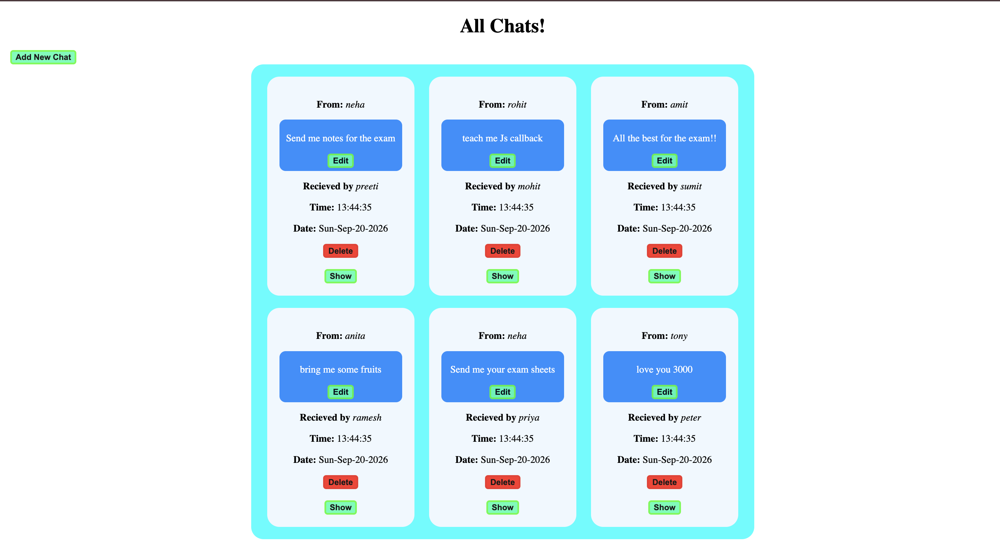

💬 Chat App

A full-stack chat application built using Node.js, Express.js, MongoDB, and EJS. This project allows users to create chats, edit and delete messages, and view chat history.

📸 Screenshots

💬 Chat Home Page

✏️ Edit Chat

➕ Create New Chat

🚀 Features

- 💬 Create Chats — Create new chat conversations.
- ✏️ Edit Messages — Update existing messages.
- 🗑️ Delete Messages — Delete existing chat records.
- 📜 Chat History — View previously created chats.
- 🗄️ MongoDB Integration — Store and manage chat data.
- ⚡ Dynamic Rendering — Render web pages using EJS.
- 🛠️ CRUD Operations — Create, read, update, and delete chat records.

🛠️ Tech Stack

- Backend: Node.js, Express.js
- Database: MongoDB
- ODM: Mongoose
- Templating Engine: EJS
- Frontend: HTML, CSS, JavaScript

📂 Project Structure

chat-app/
├── screenshots/
│ ├── home.png
│ ├── edit-chat.png
│ └── new-chat.png
├── models/
├── views/
├── public/
├── app.js
├── package.json
└── README.md

The folder structure may vary depending on your implementation.

⚙️ Installation and Setup

1. Clone the Repository

git clone YOUR_GITHUB_REPOSITORY_URL

2. Navigate to the Project Directory

cd chat-app

3. Install Dependencies

npm install

4. Start the Application

node app.js

5. Open in Browser

Visit the local URL configured in your application, for example:

http://localhost:8080

📚 What I Learned

- Building backend applications using Node.js and Express.js.
- Implementing CRUD operations.
- Integrating MongoDB with Mongoose.
- Using EJS to render dynamic web pages.
- Handling HTTP requests and Express routes.
- Organizing a full-stack web application.

🔮 Future Improvements

- User authentication and authorization.
- Real-time messaging.
- Improved user interface.
- Deployment to a cloud platform.

👨‍💻 Author

Shreyansh Mishra

- GitHub: [ShreyanshM1](https://github.com/ShreyanshM1)
- LinkedIn: https://www.linkedin.com/in/shrayansh-mishra-6a0125336/

⸻

⭐ If you find this project interesting, consider giving the repository a star!
